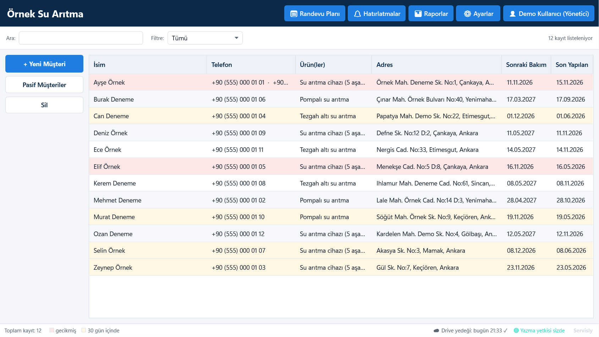
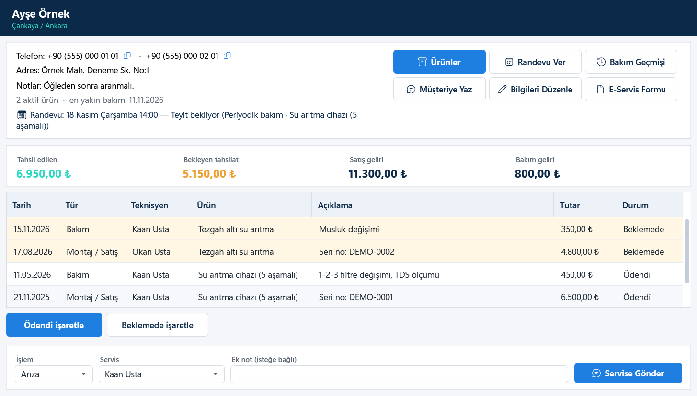
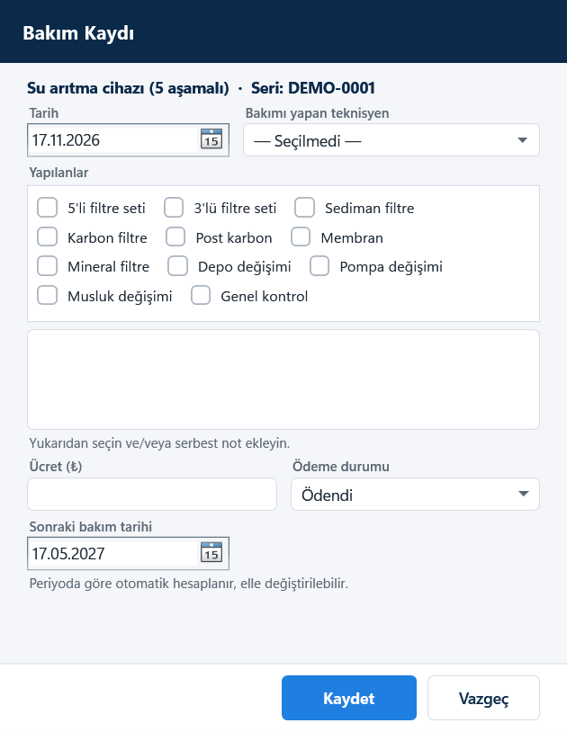
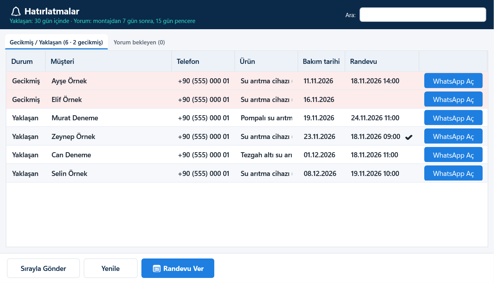
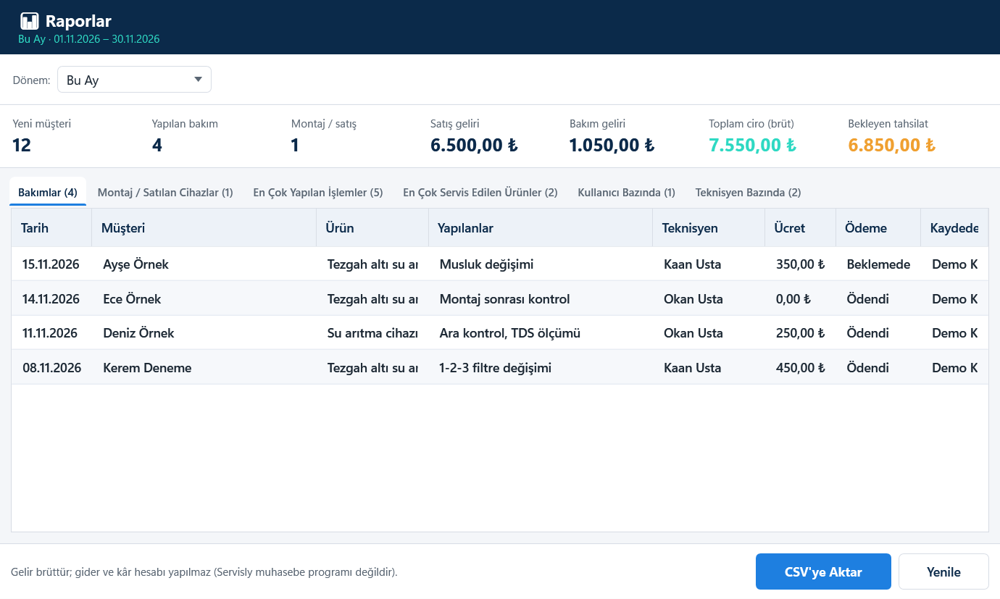
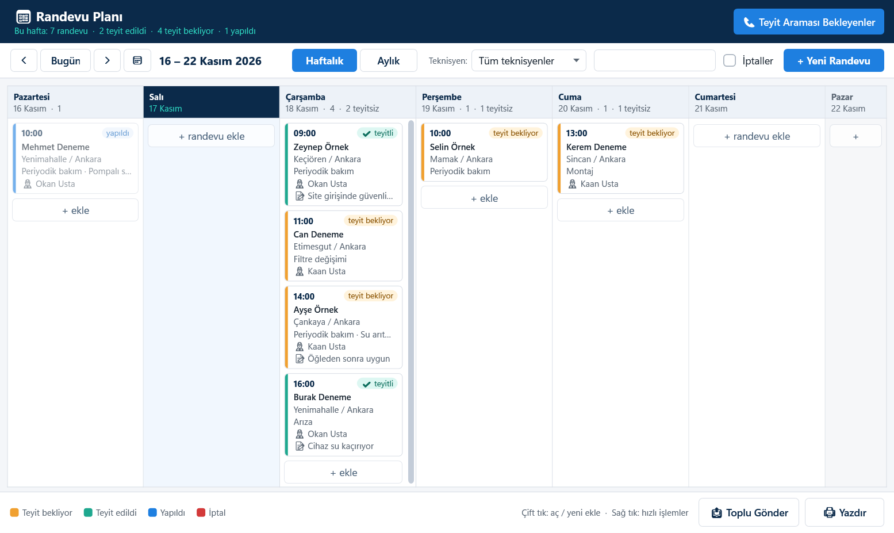
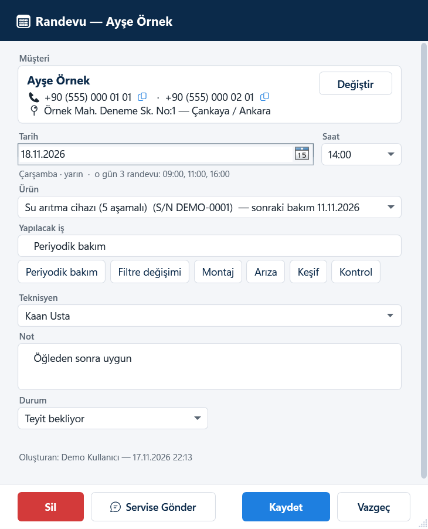
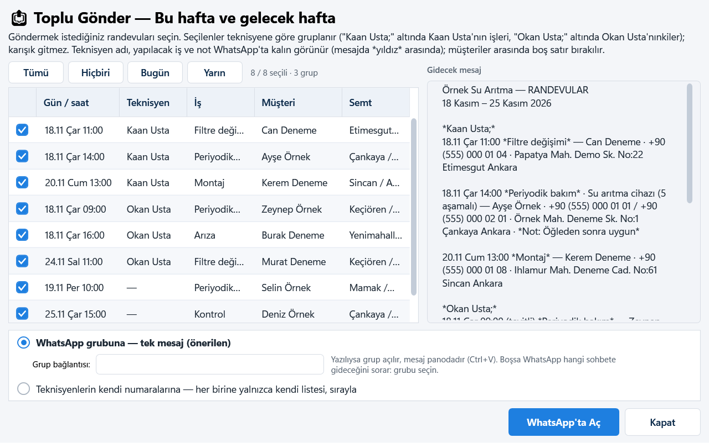
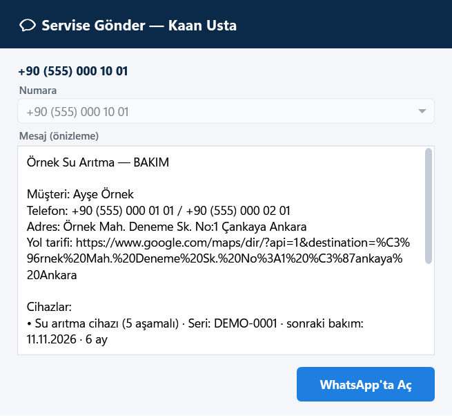
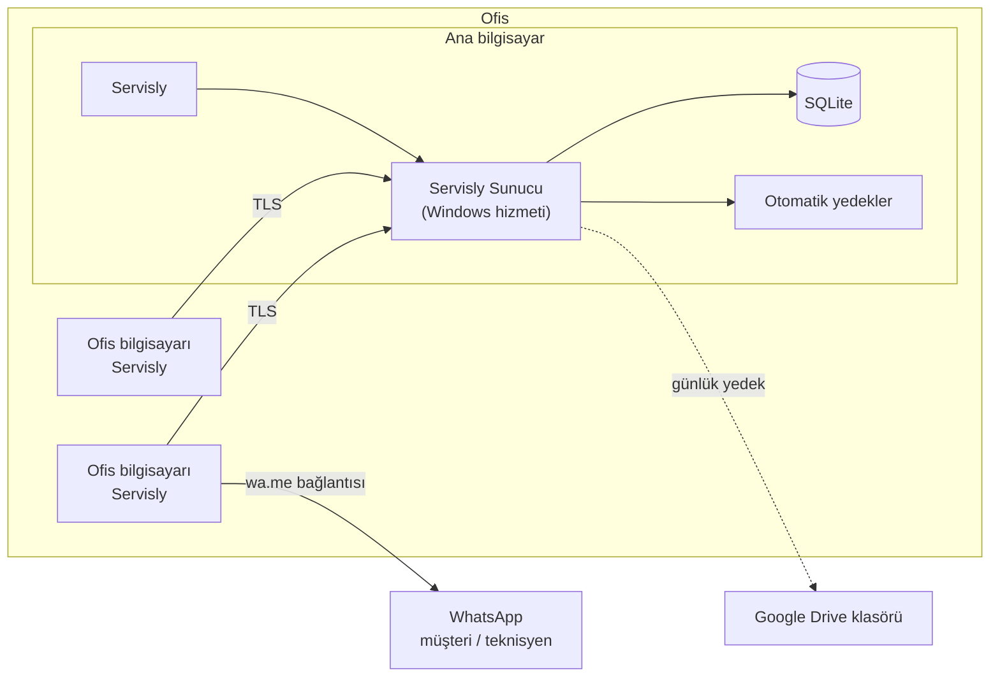

# Servisly

**Türkçe** · [English](#english)

Su arıtma ve servis firmaları için **periyodik bakım ve servis takip programı**. Windows masaüstü uygulaması: **WPF · .NET 8 · SQLite**.

> 🔒 **Kaynak kod gizlidir.** Bu depo yalnızca bir vitrindir (tanıtım ve ekran görüntüleri). Uygulamanın kaynak kodu gizli
> [Servisly](https://github.com/Xen-Onyx/Servisly) deposunda tutulur.
>
> Ekran görüntülerindeki firma, müşteri, telefon, adres ve seri numaralarının **hepsi uydurmadır** (demo veri).

## Ne işe yarar?

Su arıtma cihazı satan ve bakımını yapan firmalar; müşterilerini, cihazlarını, filtre değişim zamanlarını ve servis
işlerini tek yerden takip eder. Bakımı gelen müşteri kendiliğinden listelenir, WhatsApp'tan tek tıkla hatırlatma
gönderilir, iş teknisyene adres ve yol tarifiyle gider. Ofisteki bütün bilgisayarlar aynı veriyle, aynı anda çalışır.

## Özellikler

- **Müşteri ve cihaz takibi:** montaj tarihi, seri numarası, bakım periyodu; sonraki bakım tarihi kendiliğinden hesaplanır.
  Gecikmiş ve yaklaşan bakımlar listede renkle ayrılır.
- **Bakım kaydı:** sektöre göre hazır iş şablonları (filtre seti, membran, pompa…), ücret ve tahsilat durumu.
- **Hatırlatmalar:** gecikmiş / yaklaşan bakımlar ve kurulum sonrası yorum isteği; WhatsApp mesajı tek tek ya da sırayla.
- **Servise gönder:** iş, müşteri bilgileri, yol tarifi ve cihaz geçmişiyle teknisyenin WhatsApp'ına gider.
- **Ağ kipi:** bir bilgisayar ana bilgisayar olur (Windows hizmeti olarak çalışan sunucu); ofisteki diğer bilgisayarlar
  6 haneli kodla eşleşir ve aynı veriyle çalışır. Tek bilgisayarlı kullanım da desteklenir.
- **Yedekleme:** otomatik yedekler ve her gün bilgisayar dışı yedek (Google Drive klasörüne); uygulama kapalıyken de alınır.
- **Raporlar:** dönem bazında bakım, montaj / satış, brüt ciro, bekleyen tahsilat, teknisyen ve kullanıcı bazında; CSV'ye aktarma.
- **Kullanıcılar:** yönetici / personel yetkisi, işlem günlüğü, kurtarma kodu.
- **Telefon listesi:** sahada telefondan açılan, parolayla şifrelenmiş tek dosyalık müşteri listesi.
- Telefonu tek tıkla kopyalama, Excel'den içe aktarma, her ekranda tanıtım (F1), küçük ekranlara uyum.

## Standart ve Plus

İki paket tek kod tabanından derlenir; Plus özellikleri derleme sırasında açılır.

| | Standart | Plus |
|---|:---:|:---:|
| Müşteri, cihaz, bakım kaydı, hatırlatmalar, raporlar | ✓ | ✓ |
| Ağ kipi, yedekleme, telefon listesi | ✓ | ✓ |
| Servise gönder (WhatsApp) | ✓ | ✓ |
| **Randevu Planı:** haftalık / aylık plan, teyit araması takibi | — | ✓ |
| **Toplu Gönder:** randevular teknisyene göre gruplu tek mesajda | — | ✓ |
| **E-Servis Formu:** teknisyenin sahada telefondan doldurduğu servis formu | — | ✓ |

## Ekran görüntüleri

| | |
|---|---|
|  **Müşteri detayı:** bilgiler, tahsilat, servise gönder |  **Bakım kaydı:** hazır iş şablonları |
|  **Hatırlatmalar:** gecikmiş / yaklaşan bakımlar |  **Raporlar** |
|  **Randevu Planı** (Plus) |  **Randevu formu** (Plus) |
|  **Toplu Gönder** (Plus) |  **Servise gönder:** teknisyene giden mesaj |

## Teknolojiler

- **C# · .NET 8 · WPF**: masaüstü arayüz
- **SQLite** (Microsoft.Data.Sqlite): yerel veritabanı
- **Ağ kipi:** TLS üzerinden kendi istek / yanıt protokolü; sunucu Windows hizmeti olarak çalışır
- **ECDSA imzalı lisans**, cihaz sınırı
- **Inno Setup**: kurulum paketi · **ClosedXML**: Excel'den içe aktarma

## Mimari

Tek bilgisayarlı kullanımda Servisly veritabanını doğrudan açar; sunucu gerekmez.

## İletişim

Kurulum ya da demo için iletişim: [linkedin.com/in/kairux-dev](https://www.linkedin.com/in/kairux-dev)

---

# Servisly (English)

[Türkçe](#servisly) · **English**

A **periodic maintenance and service tracking application** for water purification and service companies. Windows
desktop application: **WPF · .NET 8 · SQLite**.

> 🔒 **The source code is private.** This repository is only a showcase (overview and screenshots). The application's
> source code lives in the private [Servisly](https://github.com/Xen-Onyx/Servisly) repository.
>
> **All** company, customer, phone, address and serial-number data in the screenshots is **fictional** (demo data).

## What it does

Companies that sell and maintain water purifiers track their customers, devices, filter replacement dates and service
jobs in one place. Customers due for maintenance are listed automatically, a WhatsApp reminder is one click away, and
jobs go to the technician with the address and directions. Every computer in the office works on the same data at the
same time.

## Features

- **Customers and devices:** installation date, serial number, maintenance period; the next maintenance date is
  calculated automatically. Overdue and upcoming maintenance is color-coded in the list.
- **Maintenance records:** ready-made job templates per industry (filter set, membrane, pump…), fee and payment status.
- **Reminders:** overdue / upcoming maintenance and post-installation review requests; WhatsApp messages one by one or in sequence.
- **Send to service:** the job goes to the technician's WhatsApp with customer details, directions and device history.
- **Network mode:** one computer becomes the main computer (server running as a Windows service); the other office
  computers pair with a 6-digit code and share the same data. Single-computer use is supported too.
- **Backups:** automatic backups plus a daily off-machine backup (to a Google Drive folder), even while the app is closed.
- **Reports:** maintenance, installations / sales, gross revenue, pending payments, per technician and per user, by period; CSV export.
- **Users:** administrator / staff roles, activity log, recovery code.
- **Phone list:** a password-encrypted, single-file customer list that opens on a phone in the field.
- One-click phone copy, Excel import, built-in tour on every screen (F1), small-screen friendly layout.

## Standard and Plus

Both editions are built from a single code base; Plus features are enabled at build time.

| | Standard | Plus |
|---|:---:|:---:|
| Customers, devices, maintenance records, reminders, reports | ✓ | ✓ |
| Network mode, backups, phone list | ✓ | ✓ |
| Send to service (WhatsApp) | ✓ | ✓ |
| **Appointment Plan:** weekly / monthly plan, confirmation call tracking | — | ✓ |
| **Bulk Send:** appointments grouped by technician in a single message | — | ✓ |
| **E-Service Form:** a service form the technician fills in on a phone in the field | — | ✓ |

## Technologies

- **C# · .NET 8 · WPF**: desktop UI
- **SQLite** (Microsoft.Data.Sqlite): local database
- **Network mode:** a custom request / response protocol over TLS; the server runs as a Windows service
- **ECDSA-signed licenses**, device limit
- **Inno Setup**: installer · **ClosedXML**: Excel import

## Architecture

See the diagram above: office computers connect to the main computer's **Servisly Server** (Windows service) over TLS;
the server owns the SQLite database, keeps automatic backups and copies a daily backup to a Google Drive folder.
Messages to customers and technicians open in WhatsApp via `wa.me` links. In single-computer use, Servisly opens the
database directly and no server is needed.

## Contact

For installation or a demo: [linkedin.com/in/kairux-dev](https://www.linkedin.com/in/kairux-dev)
